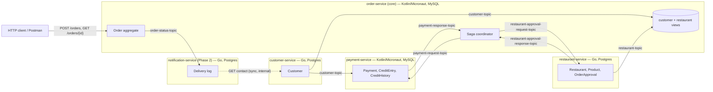
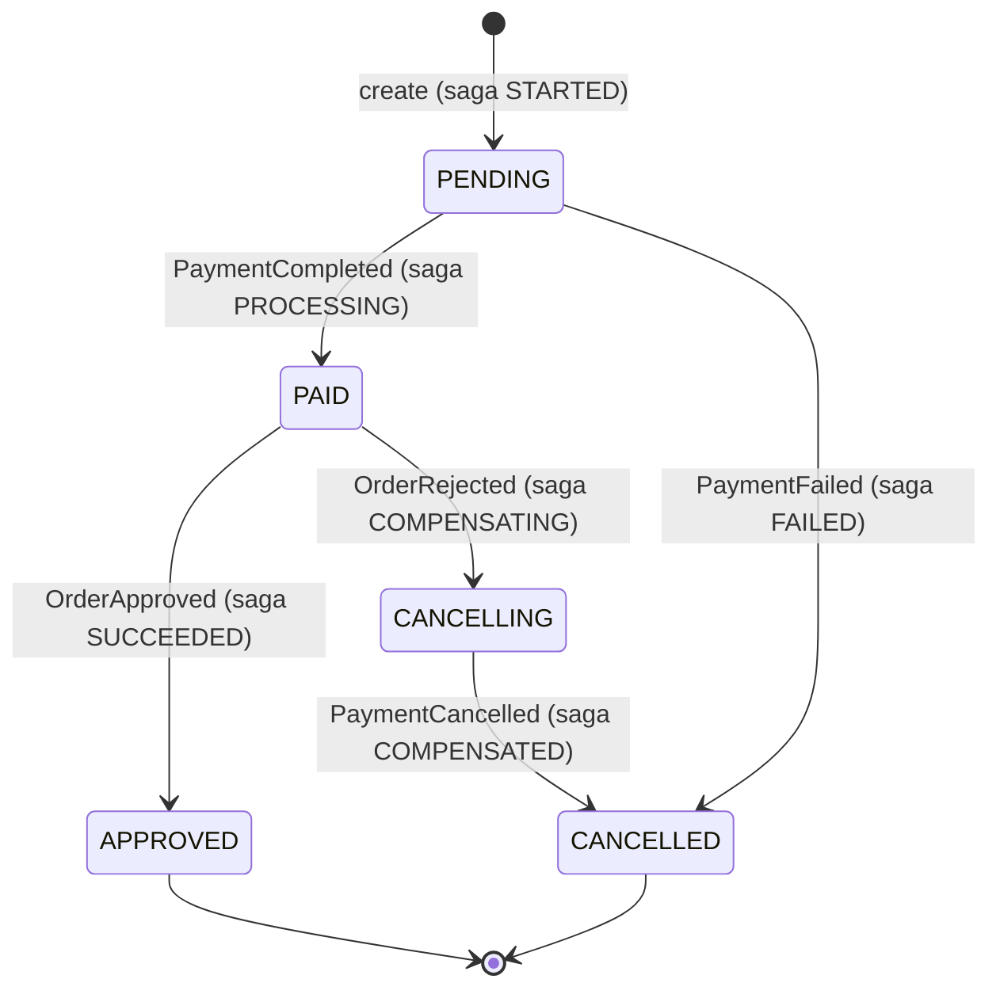
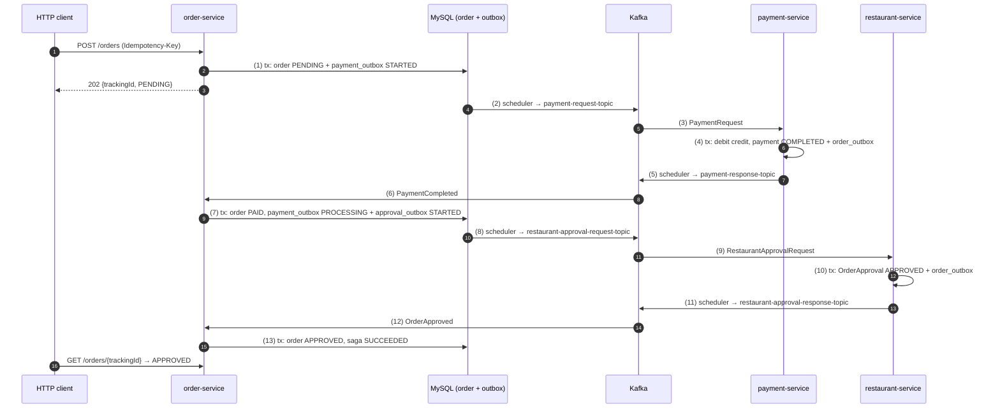

# Food Ordering System — Event-Driven Microservices in Kotlin/Micronaut and Go (Showcase Project)

Requirements document, v2.0 — 2026-10-18 (v2.0 replaces the claims-platform
domain with food ordering; the architecture follows
[`project-overview-section.png`](project-overview-section.png))

## 1. Purpose

Build a small, honest, production-shaped **food ordering system**. A customer
orders food from a restaurant. The order is paid from the customer's credit,
the restaurant approves or rejects it, and a failed step rolls back the steps
before it. Five services in two languages talk over Kafka and run on
Kubernetes. Each service has a reason to exist and a different problem to
solve:

| Service | Directory | Kind | Language, store | The hard problem it shows |
| --- | --- | --- | --- | --- |
| Order | `order-service/` | Core | Kotlin/Micronaut, MySQL | Saga coordinator, order state machine, outbox, query API |
| Payment | `payment-service/` | Supporting | Kotlin/Micronaut, MySQL | Money, credit entries and history, optimistic locking under concurrent debits, refunds as compensation |
| Restaurant | `restaurant-service/` | Supporting | Go, Postgres | Order approval against menu, availability and price; outbox |
| Customer | `customer-service/` | Supporting | Go, Postgres | Source of customer data; CQRS with materialized views in other services |
| Notification | `notification-service/` *(Phase 2)* | Generic | Go, Postgres | At-least-once delivery to email, dedup, no PII on the bus |

Shared infrastructure (Kafka, databases, Kubernetes manifests, GKE) lives in
`infrastructure/`.

The project covers the six topics listed in the diagram, each in working code:

| # | Topic (from the diagram) | Covered by |
| --- | --- | --- |
| 1 | Hexagonal (clean) architecture: ports and adapters | Every service: input ports, output ports, primary and secondary adapters; architecture tests (§8) |
| 2 | Domain-driven design | Aggregates, entities, value objects, domain services, application services, domain events (§3) |
| 3 | Saga pattern: process and rollback | Order service coordinates payment and restaurant approval, with compensating transactions (§4) |
| 4 | Outbox pattern | Outbox table in every publishing service, polled by a scheduler, saga status kept up to date; idempotency, optimistic locks, DB constraints (§6) |
| 5 | CQRS: materialized view vs event sourcing | Customer and restaurant data replicated into the order service as materialized views; ADR on why not event sourcing (§5.4) |
| 6 | Kubernetes and GKE | kind locally, GKE overlay for the cloud (§9) |

**Staff signal.** What turns this into a Staff-level artifact is the reasoning
around the code, not the amount of it: a context map, ADRs that name the
rejected option, a **failure-drill report** with expected vs observed
behaviour, and an explicit cut list. The drill report is the headline
artifact.

**Framing.** It is a demonstrator built with Claude Code as a pair, to get
current on Micronaut and to test my own understanding of event-driven design.
The README says this in its first paragraph.

## 2. Goals and non-goals

### Phasing

| Phase | Tag | Scope |
| --- | --- | --- |
| 1 | `v0.1.0` | Order, Payment, Restaurant, Customer; Kafka; kind; observability; drills D1–D9 |
| 2 | `v0.2.0` | Notification service, GKE deploy, drills D10–D12 |

Phase 1 must stand on its own. Nothing in Phase 2 may be needed to demo
Phase 1.

### Goals

- Five services, two languages, one shared contract:
    - `order-service` — Kotlin + Micronaut, MySQL. Core domain. Exposes the
      REST API (`POST /orders`, `GET /orders/{trackingId}`), owns the order
      lifecycle and is the **saga coordinator**.
    - `payment-service` — Kotlin + Micronaut, MySQL. Owns payments, customer
      credit entries and credit history. Debits on payment request, refunds on
      cancel.
    - `restaurant-service` — Go, PostgreSQL. Owns restaurants, products and
      order approvals. Approves or rejects a paid order.
    - `customer-service` — Go, PostgreSQL. Owns customers. Publishes customer
      events that other services use to build materialized views.
    - `notification-service` *(Phase 2)* — Go, PostgreSQL. Reacts to order
      status events and emails the customer.
- **Hexagonal architecture in every service**, enforced by tests: the domain
  has no framework imports; adapters depend inward.
- **DDD tactical patterns where they earn their place**: aggregates with
  invariants, value objects, domain events, domain services, application
  services, one repository per aggregate.
- **Saga with compensation**: payment and restaurant approval as two saga
  steps, each with `process` and `rollback`.
- **Outbox in every publishing service**, polled by a scheduler, with
  idempotent consumers, optimistic locks, unique constraints, retry topic and
  DLQ.
- **CQRS**: the order service never calls customer or restaurant
  synchronously; it reads its own materialized views built from events.
- **Schema contracts** in Protobuf with `buf breaking` in CI; one v1 additive
  change shipped under a rolling deploy.
- **Kubernetes**: kind with Strimzi (Kafka in KRaft mode), probes, graceful
  shutdown that drains the consumer, KEDA scaling `payment-service` and
  `restaurant-service` on consumer lag. A GKE overlay in Phase 2.
- **Observability**: one trace from `POST /orders` through Kafka to every
  service and back.
- One command per thing: `make up`, `make demo`, `make drills`, `make test`.

### Non-goals

- No frontend. Postman / a `.http` collection plays the HTTP client from the
  diagram.
- No auth beyond a static API key per caller.
- No real payment provider. Payment is a debit against the customer's credit
  entry held in `payment-service`.
- No delivery/courier tracking. The order ends at `APPROVED`.
- **No event sourcing.** State is stored as rows; events are published from
  the outbox (ADR-003).
- No real email. SMTP goes to Mailpit in the cluster.
- No real PII. Seed data is synthetic.
- No multi-region. One GKE cluster in one region at most.
- No production-hardening claims. Stated in the README.

## 3. Domain

### 3.1 Ubiquitous language

| Term | Meaning |
| --- | --- |
| Order | A customer's request for products from one restaurant, with a delivery address and a total price |
| Order item | One product, its quantity, unit price and subtotal |
| Tracking id | Public id of an order, returned to the client and used to query status |
| Order status | `PENDING`, `PAID`, `APPROVED`, `CANCELLING`, `CANCELLED` |
| Saga | The order's journey through payment and restaurant approval, coordinated by the order service |
| Saga status | `STARTED`, `PROCESSING`, `SUCCEEDED`, `COMPENSATING`, `COMPENSATED`, `FAILED` |
| Credit entry | A customer's current available credit in the payment service |
| Credit history | Append-only log of `CREDIT` and `DEBIT` movements per customer |
| Payment | The debit for one order; `COMPLETED`, `CANCELLED` or `FAILED` |
| Order approval | The restaurant's decision on one paid order; `APPROVED` or `REJECTED` |
| Outbox message | A row written in the same transaction as a state change, published to Kafka later by a scheduler |
| Materialized view | A local, read-only copy of another service's data, built from its events |
| Failure message | Human-readable reason attached to a failed or cancelled order |

### 3.2 Context map



- Order → Payment and Order → Restaurant are **customer/supplier**. The
  Protobuf schemas are the published language.
- Order **keeps materialized views** of customers and restaurant products
  (§5.4). It never calls another service synchronously to make a decision.
- Notification is a **conformist downstream** of order. It is the one place
  with a synchronous call: it fetches the customer's email from
  `customer-service` at send time, so no email address travels on Kafka.

### 3.3 Order aggregate (order-service)

Building blocks:

- **Aggregate root:** `Order` (id, customerId, restaurantId, deliveryAddress,
  price, items, trackingId, status, failureMessages).
- **Entity:** `OrderItem` (id within the order, product, quantity, price,
  subTotal).
- **Value objects:** `OrderId`, `CustomerId`, `RestaurantId`, `ProductId`,
  `TrackingId`, `StreetAddress`, `Money` (amount in cents and currency, no
  floating point), `OrderStatus`.
- **Domain service:** `OrderDomainService` — validates the order against the
  restaurant view and starts it, and applies payment and approval results.
  It works across `Order` and `Restaurant`, which is why it is not a method on
  either.
- **Domain events:** `OrderCreatedEvent`, `OrderPaidEvent`,
  `OrderCancelledEvent`, `OrderApprovedEvent`. They are returned by the domain
  and turned into outbox rows by the application layer; the domain never
  publishes.
- **Application service:** `OrderApplicationService` (input port) with
  `createOrder` and `trackOrder`; message listeners for payment and approval
  responses (input ports); repositories and outbox (output ports).

Invariants, each with a unit test:

1. An order is created only if the customer exists in the customer view and
   the restaurant is active in the restaurant view.
2. Every item's price equals the product's price in the restaurant view;
   `subTotal = price × quantity`; `order.price = sum(subTotal) > 0`.
3. The order moves only along the state machine below; every other transition
   throws `OrderDomainException`.
4. A cancelled order keeps its failure messages; failure messages are never
   empty strings.



### 3.4 Payment aggregates (payment-service)

- **Aggregate roots:** `Payment` (id, orderId, customerId, price, status),
  `CreditEntry` (customerId, totalCredit, version).
- **Entity:** `CreditHistory` (customerId, amount, type `CREDIT`/`DEBIT`).
- **Domain service:** `PaymentDomainService` — validates and initiates or
  cancels a payment across `Payment`, `CreditEntry` and `CreditHistory`.
- **Domain events:** `PaymentCompletedEvent`, `PaymentCancelledEvent`,
  `PaymentFailedEvent`.

Rules, each with a unit test:

1. `price > 0`.
2. `creditEntry.totalCredit >= price`, otherwise `PaymentFailed` with a
   failure message. A failed payment changes no credit.
3. `sum(CREDIT) − sum(DEBIT)` over the history equals
   `creditEntry.totalCredit` after the change, and is never negative.
   Otherwise `PaymentFailed`.
4. Cancel (rollback) adds the price back to the credit entry, writes a
   `CREDIT` history row and moves the payment to `CANCELLED`.
5. One payment per order: unique constraint on `payment.order_id`. A repeated
   request for the same order returns the stored outcome.
6. Concurrency: two orders by the same customer must not both spend the same
   credit. `credit_entry` has a `version` column (optimistic lock). On a
   conflict the transaction rolls back, the offset is not committed and the
   message is retried. D6 checks this.

### 3.5 Restaurant aggregate (restaurant-service)

- **Aggregate root:** `Restaurant` (id, active, products, the order being
  approved).
- **Entities:** `Product` (id, name, price, available), `OrderApproval`
  (restaurantId, orderId, status).
- **Domain events:** `OrderApprovedEvent`, `OrderRejectedEvent`,
  `RestaurantProductChanged` (feeds the order service's view).

Rules, each with a table-driven Go test:

1. The restaurant is active.
2. Every product in the order exists, is available, and has the same price as
   in the request.
3. The order total equals the sum of item subtotals.
4. Any rule failure gives `REJECTED` with all failure messages, not only the
   first one.
5. One approval per order: unique constraint on `order_approval.order_id`. A
   repeated request returns the stored outcome.

Rule 2 is checked again even though the order service validated prices against
its view: the view can lag behind a menu change. A lagging view only causes a
rejection and a refund, which the saga handles (D5).

### 3.6 Customer (customer-service)

- `POST /customers` creates a customer and writes a `CustomerCreated` outbox
  row in the same transaction. The scheduler publishes it to `customer-topic`.
- `order-service` builds its `customer` view from it.
- `payment-service` creates a credit entry for the new customer (with
  a configured starting credit, demo only).
- `GET /internal/customers/{id}/contact` (service-to-service key) returns the
  email and preferred language for the notification service.

### 3.7 Notification (notification-service, Phase 2)

One notification = one `(sourceEventId, customerId, channel)`, which is the
unique key and the dedup guarantee.

| Trigger (on `order-status-topic`) | Template |
| --- | --- |
| Order `PAID` | `order-paid` |
| Order `APPROVED` | `order-approved` |
| Order `CANCELLED` | `order-cancelled` (with failure messages) |

Rules, each with a table-driven Go test:

1. The same source event never produces two `SENT` rows (unique key;
   insert-then-send).
2. Contact details are fetched from `customer-service` right before sending
   (2s timeout, circuit breaker) and are never stored. If customer-service is
   down, the notification stays `PENDING` and is retried; it is not dropped.
3. Delivery is at-least-once. A crash between "SMTP accepted" and "mark SENT"
   sends the email again; a deterministic `Message-ID` lets the receiver drop
   the copy. The drill measures the duplicate rate instead of claiming zero.

## 4. Saga flows

The numbers match the red numbers in the diagram.

### 4.1 Happy path



### 4.2 Compensation

- **Payment fails** (not enough credit): `PaymentFailed` → order `CANCELLED`,
  saga `FAILED`. Nothing to undo.
- **Restaurant rejects** (product unavailable, price changed, restaurant
  inactive): `OrderRejected` → order `CANCELLING`, saga `COMPENSATING`, and a
  `payment_outbox` row with `paymentOrderStatus = CANCELLED` in the same
  transaction → payment-service refunds the credit → `PaymentCancelled` →
  order `CANCELLED`, saga `COMPENSATED`.

### 4.3 Saga steps

```kotlin
interface SagaStep<T> {
    fun process(data: T)
    fun rollback(data: T)
}
```

| Step | `process` | `rollback` |
| --- | --- | --- |
| `OrderPaymentSaga` | `PaymentCompleted` → order `PAID`, start approval | `PaymentCancelled`/`PaymentFailed` → order `CANCELLED` |
| `OrderApprovalSaga` | `OrderApproved` → order `APPROVED` | `OrderRejected` → order `CANCELLING`, request payment cancel |

Order status maps to saga status in one place (`SagaStatusMapper`), and every
handler updates both the order and the outbox row in one transaction ("keep
updating saga and order status for each operation").

## 5. Messaging contract

### 5.1 Topics

| Topic | Producer | Consumers | Key | Partitions |
| --- | --- | --- | --- | --- |
| `payment-request-topic` | order | payment | orderId | 3 |
| `payment-response-topic` | payment | order | orderId | 3 |
| `restaurant-approval-request-topic` | order | restaurant | orderId | 3 |
| `restaurant-approval-response-topic` | restaurant | order | orderId | 3 |
| `customer-topic` | customer | order, payment | customerId | 3 |
| `restaurant-topic` | restaurant | order | restaurantId | 3 |
| `order-status-topic` *(P2)* | order | notification | orderId | 3 |
| `<topic>.retry` | consumer | same consumer, delayed | same | 3 |
| `<topic>.dlq` | consumer | humans + `make dlq-replay` | same | 1 |

Keying by `orderId` keeps every message of one saga in order on one
partition. Ordering across topics is not guaranteed; view updates are upserts
that keep the newer version, never "insert on first event".

### 5.2 Envelope

Kafka headers modelled on CloudEvents: `ce_id` (UUIDv7, the idempotency key),
`ce_type`, `ce_source`, `ce_subject` (orderId), `ce_time`,
`ce_schemaversion`, plus W3C `traceparent`. Every saga message also carries
`sagaId`. The payload is Protobuf. Messages carry ids, enums and amounts; no
names, addresses or emails.

### 5.3 Schema evolution

- `contracts/proto/` holds the schemas; `buf lint` and `buf breaking --against
  main` run in CI.
- Only additive changes inside a topic; a breaking change means a new topic
  and a dual-publish window.
- Deliverable: add `delivery_instructions` (optional) to the order and
  `RestaurantApprovalRequest`, shipped during a rolling deploy with traffic
  running (D9).
- ADR-008: Protobuf + `buf breaking` instead of Avro + Schema Registry.

### 5.4 CQRS: materialized views vs event sourcing

- `order-service` holds `customer_view(id, version)` and
  `restaurant_product_view(restaurant_id, product_id, name, price, available,
  restaurant_active, version)`. Both are written only by Kafka listeners and
  read only by the order domain service.
- Rejected: reading another service's schema directly through a database view
  (couples deployments and schemas, and breaks database-per-service);
  synchronous REST calls on order creation (couples availability).
- Rejected: event sourcing. The order needs its current state and an audit
  of status changes, both of which rows plus outbox give. ADR-003 explains when
  event sourcing would pay off.
- Cost: the view can be stale. §3.5 shows where that is safe and how the saga
  absorbs it.

## 6. Reliability mechanics

### 6.1 Outbox tables

`order-service` has two outbox tables, one per saga step; the other services
have one each.

| Service | Table | Status columns |
| --- | --- | --- |
| order | `payment_outbox`, `restaurant_approval_outbox`, `order_status_outbox` (P2) | `saga_status`, `order_status`, `outbox_status` |
| payment | `order_outbox` | `payment_status`, `outbox_status` |
| restaurant | `order_outbox`, `restaurant_outbox` | `approval_status`, `outbox_status` |
| customer | `customer_outbox` | `outbox_status` |

Common columns: `id`, `saga_id`, `type`, `payload`, `created_at`,
`processed_at`, `outbox_status` (`STARTED`, `COMPLETED`, `FAILED`),
`version`.

### 6.2 Failure scenarios from the diagram

| Scenario | Mechanism |
| --- | --- |
| **Idempotency using the outbox table** | A response handler first looks up the outbox row for `(saga_id, expected saga_status)`. If none matches, the message was already handled and is skipped. Unique constraint on `(type, saga_id, saga_status)` in order and on `(type, saga_id, payment_status / approval_status)` in payment and restaurant, so a duplicate insert fails instead of creating a second step. |
| **Concurrency: optimistic locks and DB constraints** | `version` columns on `orders`, `credit_entry` and every outbox table. Two pods handling the same response race; the loser gets an optimistic-lock failure, which is logged as "already processed", not retried. Unique constraints on `payment.order_id` and `order_approval.order_id`. |
| **Keep saga and order status up to date** | Every handler changes the order and its outbox row in one transaction, through `SagaStatusMapper`. |

### 6.3 Schedulers

- **Outbox publisher** (every 1s per service): selects `STARTED` rows with
  `SELECT ... FOR UPDATE SKIP LOCKED`, publishes with an idempotent producer,
  marks `COMPLETED` (or `FAILED` on a send error) after the broker acks.
- **Outbox cleaner** (hourly): deletes `COMPLETED` rows older than 24h, in
  batches.
- Safe to run on several pods because of `SKIP LOCKED`. Publishing is still
  at-least-once (crash after ack, before mark); consumers are idempotent.

### 6.4 Consumers, retries, shutdown

| Mechanism | Kotlin services (order, payment) | Go services (restaurant, customer, notification) |
| --- | --- | --- |
| Offsets | Micronaut Kafka, auto-commit off, commit after the tx commits | franz-go, manual commit after the tx commits |
| Retry | Transient errors (deadlock, optimistic-lock conflict on credit, timeout) go to `.retry` with attempt count and backoff | Same |
| DLQ | Decode failure, unknown message type, invariant violation, or attempts > 5 | Same |
| Shutdown | On SIGTERM: stop polling, finish the in-flight record, commit, close; `preStop` sleep | Same, via `context` cancellation |
| HTTP idempotency | `Idempotency-Key` on `POST /orders`, stored with the response for 24h | `POST /customers` |

MySQL specifics: UUIDv7 stored as `BINARY(16)` to keep InnoDB's clustered
index compact; every Flyway migration is safe to re-run, since MySQL DDL is
not transactional.

**Database per service on a shared instance** (demo): MySQL hosts `order` and
`payment`; Postgres hosts `restaurant`, `customer` and `notification`. Each
service has its own user with grants on its own database only.

## 7. REST API (order-service)

```http
POST /orders
Idempotency-Key: 0192...
{
  "customerId": "…", "restaurantId": "…",
  "address": { "street": "…", "postalCode": "…", "city": "…" },
  "price": 5000,
  "items": [ { "productId": "…", "quantity": 1, "price": 5000, "subTotal": 5000 } ]
}
→ 202 { "orderTrackingId": "…", "orderStatus": "PENDING", "message": "Order created" }

GET /orders/{trackingId}
→ 200 { "orderTrackingId": "…", "orderStatus": "CANCELLED", "failureMessages": ["Product 'Pizza' is not available"] }
```

Errors are RFC 9457 Problem Details. Validation errors from the domain are
`422`, unknown tracking id is `404`. A Postman collection and an
`order-service/http/orders.http` file are part of the deliverable.

## 8. Hexagonal layout

### 8.1 Kotlin services (`order-service`; `payment-service` mirrors it)

Gradle multi-module, so dependency direction is enforced by the build as well
as by tests:

```text
order-service/
  order-domain/
    order-domain-core/          # Order, OrderItem, value objects, domain events,
                                # OrderDomainService. Pure Kotlin, no Micronaut.
    order-application-service/  # OrderApplicationService, saga steps, SagaStatusMapper,
                                # outbox schedulers, DTOs,
                                # ports/input  (OrderApplicationService, PaymentResponseListener,
                                #               RestaurantApprovalResponseListener, view listeners)
                                # ports/output (OrderRepository, views, outbox repositories,
                                #               message publishers)
  order-adapters/
    order-rest/                 # primary: @Controller, Problem Details
    order-messaging/            # primary: @KafkaListener; secondary: publishers, Protobuf mapping
    order-dataaccess/           # secondary: Micronaut Data JDBC, MySQL, Flyway
  order-container/              # Micronaut Application, wiring, config, Dockerfile
  http/orders.http
```

`payment-service` has the same shape with `payment-domain-core` (Payment,
CreditEntry, CreditHistory, PaymentDomainService) and no REST adapter beyond
health, plus an internal `POST /credit` for seeding.

Konsist tests fail the build if `*-domain-core` imports `io.micronaut.*`,
`jakarta.*` or any adapter, or if `*-application-service` imports an adapter.

### 8.2 Go services (`restaurant-service`; `customer-service` and `notification-service` mirror it)

```text
restaurant-service/
  cmd/restaurant/            # main: config, wiring, signal handling
  internal/domain/           # Restaurant, Product, OrderApproval, rules — stdlib only
  internal/app/              # command handlers, ports (RestaurantRepo, Outbox, Publisher, Clock)
  internal/adapter/pg/       # pgx + sqlc, goose migrations
  internal/adapter/kafka/    # franz-go consumer, outbox publisher
  internal/adapter/http/     # health, readiness, metrics (+ menu admin API)
```

`customer-service` adds the `POST /customers` and internal contact endpoints
in `internal/adapter/http/`. `notification-service` adds
`internal/adapter/smtp/`, `internal/adapter/customer/` (contact lookup behind
a `ContactDirectory` port) and `internal/templates/` (`embed.FS`).

An `archtest` runs `go list -deps` and fails if `internal/domain` imports
anything outside the standard library, or `internal/app` imports
`internal/adapter/...`.

## 9. Kubernetes and GKE

```text
infrastructure/
  compose/compose.yaml        # fast inner loop without Kubernetes
  k8s/
    base/                     # Deployments, Services, PDBs, ConfigMaps per service
    overlays/local/           # kind
    overlays/gke/             # GKE (Phase 2)
    strimzi/                  # Kafka (KRaft) + KafkaTopic resources for §5.1
    keda/                     # ScaledObjects
    mailpit/                  # Phase 2
  terraform/gke/              # GKE cluster, Artifact Registry, Cloud SQL (Phase 2)
  seed/                       # synthetic customers, restaurants, products
```

- **Local:** kind cluster created by `make up`. Strimzi with 1 broker
  (manifests ready for 3). MySQL 8 and Postgres 16 as single-replica
  StatefulSets.
- Liveness probes check the process. Readiness fails while the consumer is
  not assigned or the outbox publisher is stuck for more than 30s.
- KEDA `ScaledObject`s on consumer-group lag for `payment-service` and
  `restaurant-service` (1 → 3 replicas, capped at the partition count, with a
  comment saying why). `order-service` stays at 2 replicas.
- PodDisruptionBudget for every service; `terminationGracePeriodSeconds`
  matches the drain logic.
- grafana/otel-lgtm as one pod for traces, metrics and logs.
- **GKE (Phase 2):** Terraform for a regional GKE Standard cluster, Artifact
  Registry, Cloud SQL for MySQL and Postgres (private IP, Cloud SQL Auth
  Proxy sidecar), Workload Identity instead of key files. Strimzi stays in the
  cluster (rejected for the demo: Confluent Cloud, Managed Kafka for Apache
  Kafka on GCP — named in ADR-012 as the production choice). `make gke-up` /
  `make gke-down`; the README states the hourly cost and says to tear it down.

## 10. Observability and SLOs

- OpenTelemetry in all services. `traceparent` is stored in the outbox row and
  extracted on consume, so one trace spans the HTTP request, payment,
  restaurant and the replies.
- One Grafana dashboard: orders per status, sagas per status, outbox lag
  (oldest `STARTED` row age) per service, consumer lag per group, DLQ depth,
  optimistic-lock conflicts per service, time from `POST /orders` to a
  terminal status (p95).
- SLOs in `docs/slo.md`:
    - 99% of orders reach `APPROVED` or `CANCELLED` within 30 seconds.
    - Outbox lag under 5s for 99.9% of minutes.
    - *(Phase 2)* 99% of emails are sent within 2 minutes of the status change.
- One burn-rate alert rule per SLO (PrometheusRule YAML).

## 11. Failure drills (headline artifact)

`make drills` runs each drill against the local stack and writes
`docs/drills.md`: setup, fault injected, expected, observed, metric screenshot
or log excerpt, fix if it failed. A drill that failed first, with its fix, is
worth more than one that passed.

| # | Phase | Drill | Expected |
| --- | --- | --- | --- |
| D1 | 1 | SIGKILL `payment-service` during 500 orders | No double debit (credit history sums match every credit entry); every order reaches `APPROVED` or `CANCELLED` |
| D2 | 1 | Stop Kafka for 60s while submitting orders | API keeps returning 202; outboxes grow, then drain; no order lost |
| D3 | 1 | Publish a poison message to `payment-request-topic` | Goes to `.dlq` after decode failure; partition not blocked |
| D4 | 1 | Replay `payment-response-topic` and `restaurant-approval-response-topic` from offset 0 | No status changes, no new outbox rows, duplicates counted as skipped |
| D5 | 1 | Mark a product unavailable after the order view was built, then order it | Restaurant rejects; payment refunded; order `CANCELLED` with failure message; credit restored to the cent |
| D6 | 1 | 50 concurrent orders by one customer whose credit covers 10 | Exactly 10 `PAID`; credit never negative; optimistic-lock conflicts counted and retried |
| D7 | 1 | Run 3 `order-service` pods, kill one mid-burst | No saga stuck; duplicate publishes measured and all absorbed by idempotent consumers |
| D8 | 1 | Burst of 2,000 orders | KEDA scales payment and restaurant; lag recovers; time to drain recorded |
| D9 | 1 | Rolling deploy of the additive schema change (§5.3) + a MySQL expand migration under load | Zero 5xx, zero DLQ entries |
| D10 | 2 | Stop `customer-service` for 2 minutes during an email burst | Notifications stay `PENDING`, breaker opens, all are sent after recovery; none dropped |
| D11 | 2 | Kill `notification-service` between SMTP accept and mark-sent, 1,000 emails | Duplicate rate measured and reported; every duplicate has the same `Message-ID` |
| D12 | 2 | GKE: drain a node running `order-service` and `payment-service` under load | PDBs hold; no lost orders; p95 within SLO |

## 12. ADRs (`docs/adr/`)

Each ADR is under a page: context, decision, options rejected, consequences.

| # | Phase | Decision |
| --- | --- | --- |
| 001 | 1 | Services per bounded context; why not a modular monolith (and when I would pick one) |
| 002 | 1 | Kotlin/Micronaut for order and payment (money, saga); Go for restaurant, customer, notification |
| 003 | 1 | State-stored aggregates + outbox, not event sourcing |
| 004 | 1 | Orchestrated saga in the order service, not choreography between payment and restaurant |
| 005 | 1 | Pay first, then ask the restaurant (and the refund cost of that order) |
| 006 | 1 | Optimistic locking on credit entry and outbox rows; when pessimistic locking would win |
| 007 | 1 | Partition key `orderId` for saga topics |
| 008 | 1 | Protobuf + `buf breaking` instead of Avro + Schema Registry |
| 009 | 1 | Polling outbox publisher instead of Debezium CDC |
| 010 | 1 | Materialized views from events instead of cross-schema DB views or sync calls |
| 011 | 2 | Choreography for notifications; contact lookup at send time, no PII on Kafka |
| 012 | 2 | GKE + Cloud SQL + in-cluster Strimzi for the demo; managed Kafka for production |

## 13. Testing

| Level | Kotlin services (order, payment) | Go services (restaurant, customer, notification) |
| --- | --- | --- |
| Domain unit | Kotest: order state machine, price validation, credit rules | Table-driven: approval rules, dedup |
| Application | Use cases and saga steps with in-memory fakes of every port | Handlers with fakes |
| Integration | `@MicronautTest` + Testcontainers (MySQL, Kafka): outbox round trip, duplicate response, optimistic-lock conflict | Testcontainers (Postgres, Kafka): consumer idempotency, outbox |
| Architecture | Konsist | `archtest` via `go list -deps` |
| Contract | `buf breaking` in CI | same |
| End to end | `make demo` on kind: approved order, payment-failed order, restaurant-rejected order with refund | — |

CI: GitHub Actions runs lint, unit, integration and buf on every PR. kind,
GKE and the drills run outside CI (stated in the README).

## 14. Repository

```text
food-delivery-system/
  contracts/proto/            # order/v1, payment/v1, restaurant/v1, customer/v1, buf.yaml
  order-service/              # Kotlin/Micronaut, MySQL — saga coordinator, REST API
  payment-service/            # Kotlin/Micronaut, MySQL
  restaurant-service/         # Go, Postgres
  customer-service/           # Go, Postgres
  notification-service/       # Go, Postgres (Phase 2)
  infrastructure/             # compose, k8s (kind + GKE), strimzi, keda, terraform, seed
  drills/                     # D1–D12 scripts
  docs/                       # design.md, adr/, drills.md, slo.md, migration-playbook.md
  Makefile
  README.md
  REQUIREMENTS.md
```

## 15. Definition of done

### v0.1.0 (Phase 1)

- [ ] `make up && make demo` works from a clean clone in under 10 minutes and
      shows the three end-to-end paths (§13).
- [ ] Both architecture tests are green, and a deliberate violation turns them
      red (screenshot in the README).
- [ ] D1–D9 run and are written up in `docs/drills.md`, including any that
      failed first.
- [ ] One trace in Grafana spans order → payment → order → restaurant → order.
- [ ] ADR 001–010 written.
- [ ] README opens with the framing paragraph and the diagram.

### v0.2.0 (Phase 2)

- [ ] Order emails visible in Mailpit for approved and cancelled orders.
- [ ] D10–D12 written up, with the measured duplicate rate from D11 as a
      number.
- [ ] The stack runs on GKE via `make gke-up`, and `make gke-down` removes
      everything.
- [ ] ADR 011–012 written.

## 16. Interview map

| Question | Point at |
| --- | --- |
| "How do you avoid dual writes?" | Outbox in every publishing service (§6.1), D2 |
| "Exactly-once?" | At-least-once + idempotent handling via outbox lookup and unique constraints (§6.2, D4, D7); where it is impossible: email (§3.7, D11) |
| "Saga, compensation?" | §4, refund path, D5; ADR-004/005 |
| "Concurrency?" | Optimistic locks on credit and outbox, unique constraints, D6; ADR-006 on when pessimistic wins |
| "CQRS / event sourcing?" | Materialized views (§5.4), ADR-003, ADR-010 |
| "Ordering?" | `orderId` keys (§5.1), ADR-007, upsert views across topics |
| "Hexagonal / DDD?" | Module layout (§8), architecture tests, the domain service that spans Order and Restaurant |
| "Schema changes?" | §5.3, D9 |
| "Kubernetes in production?" | Graceful drain, readiness on consumer assignment, KEDA on lag, PDBs, GKE overlay, D8, D12 |
